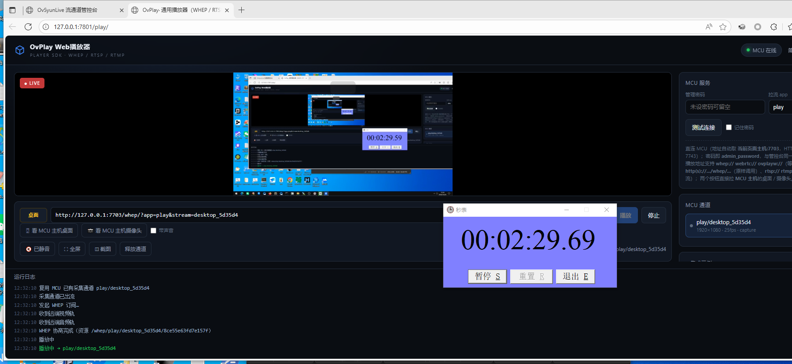
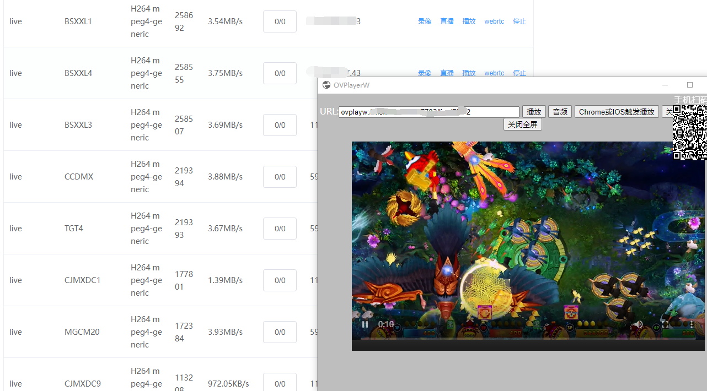
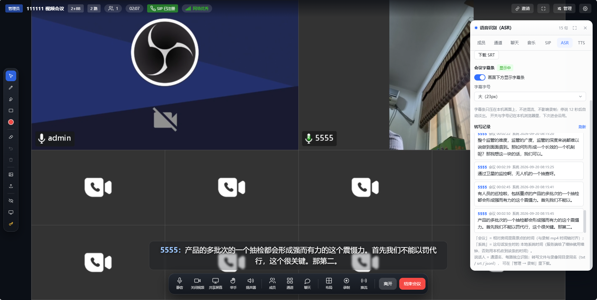

# ovsyunlive
这是一套网页直播,监控,视频会议,视频对讲,Web视频推流,Web免插件极速rtsp/rtmp播放，电子游戏直播，桌面远程控制，游戏远控，支持H5监控直播，微信直播会议，RTSP、RTMP网页低延时播放，支持srt,Webrtc,http-flv,ws-flv,Pc可以不用flash,全套低延时,针对硬件游戏机远控推流做了低延时的转码和转发,能在线H5互动游戏,web监控,低延时解决方案,此项目后台Web管理开源，整套方案提供绿色安装包.

特点：

**极简Web免插件rtmp/rtsp/webrtc播放(二行代码)， Web低延时在线 直接推流rtmp/rtsp/webrtc。**

**全面支持取win/linux/arm/android设备摄像头麦克风，支持取桌面+外放音频。**

**极简Web自建视频会议，私有云，视频交互项目，绿色启动，webrtc/rtsp/rtmp 一键参会，一链分享接入。**

**智能分发播放，如拉rtsp播放，多个终端同时会只拉路rtsp再分发到终端，减少多路采拉rtsp。**

**自动智能音频转码，播放自动转码到浏览器识别的，web推流rtmp自动转码为H264,AAC为大众平台兼容。**

**Web极低延时100毫秒左右的直播推流和播放，web在线低延时会议直播推流（可定调Web会议在线直播推流）**
 
商业需求QQ:1410919373 QQ群：216403866 ​

Win64测试包：<a href='https://m.ovmeet.com/ovsyunlive13-windows.zip'>https://m.ovmeet.com/ovsyunlive13-windows.zip</a> 
Linux测试包：<a href='https://m.ovmeet.com/ovsyunlive13-linux.zip'>https://m.ovmeet.com/ovsyunlive13-linux.zip</a> 
Windows系统，1.解压  2.配ovmeetmcu.ini上IP  3.运行 双击start.bat  4.停止：stop.bat  
Linux-debian12系统，  1.解压  2.配ovmeetmcu.ini上IP  3.授权 chmod -R 777 ./ovsyunlive/*  4.运行 ./start.sh  5.停止：./stop.sh  
服务程序配IP，要配ovmeetmcu.ini的public_ip =公网IP.(内网也可以配内网IP重启) 
演示地址:https://m.ovmeet.com:7702/play/ 
	
1，全面支持取win/linux/arm/android设备摄像头麦克风，支持取桌面+外放音频， 
rtsp播放，桌面分享web打开，超低100毫秒延时 
演示地址：http://m.ovmeet.com:7702/play/demo.html</a> 

  
2.超低延播放器代码集成：详见sdk文档和播放demo代码，网页嵌入ovplayer.js，指定ovsyunlive服务器地址，播放rtsp/rtmp流。 
    var player = new OvPlayer('#video', {server: 'http://' + location.hostname + ':7703', password: '', muted: true,}); 
    // 播放：随便哪种地址 rtsp,rtmp,whep,webrtc,ovplayw,桌面和摄像头 
    player.play('rtsp://192.168.1.64:554/Streaming/Channels/101'); 
    // player.play('whep://192.168.0.13:7703/live/cam1'); 
    // player.play('http://192.168.0.13:7703/whep/?app=live&stream=cam1'); 
    // player.playDesktop(); 主机主屏 
    // player.playCamera();　主机摄像头 
    // 停止  
    // player.stop();  
			 
3.whip/rtsp推流测试： 
          whip推流地址: http://IP:7703/whip/?app=live&stream=2222 
          rtsp推流地址: http://IP:7554/live/2222 
     

   
4. Android-APP:<a href='https://w.ovmeet.com:9301/OvMeetMCU.apk'>https://w.ovmeet.com:9301/OvMeetMCU.apk</a> 
         webrtc播流地址：webrtc://IP:7703/live/2222  
         rtsp播流地址：rtsp://IP:7554/live/2222 
         whep播放地址: http://IP:7703/whep/?app=live&stream=2222 
           
5. 公网测试,一定要确认rtsp/rtmp地址公网可用，测试页请不要长时间挂机播放 如有需求QQ:<a href='tencent://message/?uin=1410919373&amp;Site=qq&amp;Menu=yes'>1410919373</a> 
       
6. 视频会议功能： 
标准SIP/P2P/WEBERC/RTSP/RTMP/RTP/SDP会议广播，直播，监控，MCU/SFU融合通信视频系统 
1，已全面支持Android设备上直播服务/会议系统/SIP广播，无需专门服务器，一台手机也能搞定。 
2，不需要专门SIP服务器和帐号，内网SIP主动搜索终端P2P推拉流参会，同时也兼容SIP注册服务,SIP公网服务型会议 
3，兼容大厂商的标准SIP终端，宝利通，华为，方位，亿联各种标准SIP设备， 
4，支持SIP终端主发呼入参会，可以互相呼叫广播，会议，视频通话语音通话，会话批量管理。 
5，支持内网P2P+公网SIP服务混合会议，级联或跨地域跨网络视频会议对接 
6，支持各种流协议，和各种摄像头，监控平台对接，融屏参会，WHEP/RTMP/RTSP/RTMP,WebRTC,RTP,SDP,Mp4,Mp3, 
7，强大的背景广播音乐，视频播放，视频录像，单通道录像 
8，强大的分发功能，推流转发，单通道转发，混流，Webrtc/whep/RTSP直接播放观看，RTSP/WHEP直接推流参会， 
9，支持H264,H265,OPUS,G711,AAC 
10，支持强大布局，UI定调，坐席，标签，码流，分辩率调整。 
11，支持AR接入，视频标注,支持终端对焦，快照，缩放. 
12，本地离线模型及时ASR/TTS语音转录，400毫秒内及时转录，方便对接AI模型 
13，简单易用，可提供测试包，或定制arm/linux/windows 
       
Android-mcu测试服务端下载：https://w.ovmeet.com:9301/OvMeetMCU.apk 
       
基于全新的架构SIP视频对讲广播会议系统 
OvMeet-PBX融合通信平台，一体化集成，化繁为简​，高清视频对讲，面对面的沟通​，强大广播功能，信息一键传达​ 
OvMeet-MCU演示：https://m.ovmeet.com:9903 商业需求QQ:1410919373 ​ 
OvMeet-PBX演示：https://w.ovmeet.com:3301　 
OvMeet-PBX下载：http://www.ovmeet.com/pbx/index.html win绿色安装包 
SIP/WEBRTC/RTSP/融合系统 

  

